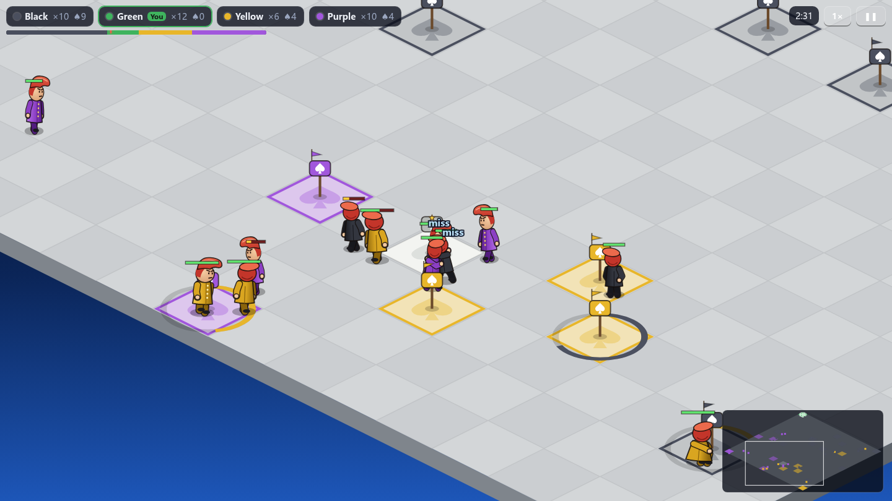
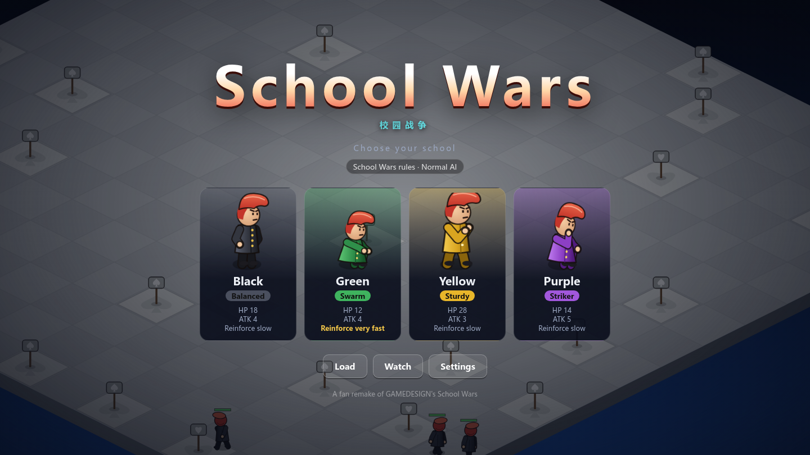

<div align="center">

# School Wars · 校园战争

**A fan remake of GAMEDESIGN's classic Flash real-time strategy game *School Wars***

[简体中文](README.md) | English

[](https://schoolwars.yhdmt.site)
[](https://github.com/mituan-ai/school-wars/releases)
[](LICENSE)




</div>

Four high schools (Human, Orc, Dwarf and Elf), one 16×16 isometric schoolyard, and two commands: **move** and **attack**. Idle students sit down. Sitting on a **camp** captures it and speeds up your reinforcements; sitting on a **spring** heals. Sit on a rival's base until it falls, knock out their last student, and that school is out.

The remake first rebuilt every rule of the original SWF function by function. It then fixed what made the original drag on or feel unfair, without adding any new systems.

## ✨ Highlights

- **Two rule sets, switchable in Settings**
  - **School Wars (default)**: games reach an ending and fights feel fair. Games still undecided after 40 minutes fell from 57% in the original to 1.7%.
  - **Classic**: a frame-exact recreation of the original, including the original AI.
- **Four-player online play**: when creating a room, pick **Server mode** (the game runs on the server, everyone gets the same latency, and nobody's disconnect affects the others) or **Player-host mode** (the game runs in the host's browser and the others connect to the host directly, so the data takes the short route). Empty seats can be filled with computer players at a chosen level. A player who drops is covered by the computer after 15 seconds and gets their school back on return. If the host leaves, another player takes over automatically.
- **An AI that doesn't cheat**: the computer plays by the same rules and uses the same commands as you. There are three levels (Easy, Normal, Hard), and each school has its own personality.
- **Four races, one trait each**: Humans capture faster, Orcs swarm, Dwarves heal faster and Elves are harder to hit. Each has its own look, building and yard.
- **Comfortable controls**: pathfinding that walks around people, precise clicking with a glowing outline on selected students, attack-move (`A`), one-key retreat to heal (`H`), route lines, control groups, rally points, threat alerts and hover tooltips.
- **Everything redrawn**: students, school buildings, camp tents, springs and the campus greenery are drawn in code, and the sound effects are synthesized with WebAudio. The repository contains no original assets.
- **Chinese and English UI**, plus saving and loading (3 manual slots and an autosave, with import and export), pause and 2× speed, and a colorblind mode.
- **Instant play**: it runs in the browser with no runtime dependencies. The production bundle is about 146 KB (50 KB gzipped). Online play also needs a small Node service (rooms, signalling, relay, and the game itself in Server mode).

<div align="center">

</div>

## 🎮 How to play

| | Rule |
|---|---|
| **Camps** (tents) | Sit on one to capture it. The more camps you hold, the faster your reinforcements arrive |
| **Springs** (stone wells) | Sit on your own spring to heal. They can be captured too |
| **Base** | Each school's home: it spawns students and heals them. If enemies sit on your base for about 33 student-seconds, it **falls**: no more reinforcements and no healing. Sit on it again for about 17 student-seconds to retake it |
| **Elimination** | Your base has fallen and you have no students left |
| **Growth** | Each knockout heals the student 30% and raises their max HP by 2, with a pillar of light. Every 3 knockouts drops a star above their head and makes them a veteran |
| **Top dog** | A school holding more than 40% of the board's strength becomes the computer's preferred target (this rule turns off once only two schools remain) |

Punches land 50% of the time, and a whiff shows "miss". A hit interrupts the target's own punch, so ganging up is strong. That is the soul of the original, and the remake keeps it intact.

### Controls

| Action | Input |
|---|---|
| Select | Left-click or drag a box · `Shift` + click to add or remove, `Shift` + drag to add · double-click a student to select all of yours on screen · `Ctrl` + `A` selects everyone |
| Move / attack | Right-click the ground / right-click an enemy |
| Attack-move | `A`, then click the ground: fight any enemy within 6 cells on the way, then keep going |
| Retreat to heal | `H`: selected students walk to your nearest spring or base; with nothing selected, all wounded students retreat · `Shift` + `H` selects all wounded |
| Groups | `Ctrl` or `Shift` + number to assign · number to select · press twice to jump the camera there |
| Rally point | Click your school building, then right-click the ground; new students walk there · right-click your base to clear it |
| Camera | `Space` + drag · `WASD` / arrow keys · click the minimap · mouse wheel to zoom |
| Pause / speed | Buttons in the top-right corner |

### The four schools

| School | Style | Trait | HP | ATK | Reinforcements |
|---|---|---|---|---|---|
| 🔵 Human High | Balanced, expansion | **United**: captures 30% faster | 17 (classic 20) | 4 | Slow |
| 🟢 Orc High | Swarm | **Horde**: very fast reinforcements | 12 (classic 10) | 4 (classic 2) | Very fast |
| 🟡 Dwarf High | Sturdy | **Hardy**: heals twice as fast | 28 (classic 25) | 3 | Slow |
| 🟣 Elf High | Striker | **Nimble**: hit only 42% of the time (others 50%) | 12 (classic 15) | 5 | Slow |

The four races are reworked from the original's Black, Green, Yellow and Purple schools. The values in brackets are the original's, used under Classic rules; Classic uses the new looks too, but without traits. The new values were tuned over thousands of headless games. In the original, Green (now Orc) won 0% of AI-only games.

## 🔧 What changed from the original

Every change fits in one sentence and was checked with headless simulations:

- **Games reach an ending**:
  - Bases can be taken.
  - Reinforcements bank up while you're at the unit cap instead of being wasted.
  - Capture progress slowly decays when nobody keeps it up.
  - "Top dog" turns off once only two schools remain, and no longer protects a school whose base has fallen.
- **Fairer fights**:
  - Idle students engage the nearest enemy, and prefer one that is hitting their teammates, instead of picking one at random.
  - Moving units can be hit.
  - Students on a move order aren't pulled away by enemies.
  - Automatic chases stop after 12 cells.
  - Knocked-out students free their cell immediately.
- **Easier to control**: A* pathfinding walks around blockers and stops next to an occupied target; attack-move and retreat-to-heal are one key each.
- **Easier to read**: a strength bar, capture rings, a reinforcement timer, "miss" pop-ups, hit flashes, level-up light pillars and veteran auras, selection outlines and hover tooltips.

The full design, data and trade-offs are in [docs/03_优化方案.md](docs/03_优化方案.md) and [docs/04_体验升级方案.md](docs/04_体验升级方案.md) (Chinese).

## 🤖 AI results

All numbers come from reproducible headless simulations (`npm run sim`, capped at 40 minutes):

| Matchup | Result |
|---|---|
| 4 × Normal free-for-all (300 games) | Human / Orc / Dwarf / Elf win rates 24 / 23 / 27 / 25%, median length 13 min, 1.7% undecided |
| 4 × Hard free-for-all (300 games) | 29 / 34 / 27 / 11%; Elves are weak |
| Hard vs original AI (180 games) | Hard wins 94.3% |
| Normal vs original AI (180 games) | Normal wins 84.2% |
| Hard vs Normal (180 games) | Hard wins 89.9% |

At regular intervals, a commander reassesses the board and assigns each student to one of four tasks: retreat, defend, expand or attack. It can only issue the same commands a player can, never reads hidden information, and gets no stat bonuses. The three levels differ only in reaction speed, coordination and whether the AI focuses its fire.

## 🌐 Online play

On the title screen choose "Online", enter a name, pick a mode and a ruleset, create a room and send your friends the invite link (`?room=CODE`). The lobby shows each player's latency to the server and whether each pair of players can connect directly (and how fast), and it recommends a mode based on those measurements.

| | Server mode | Player-host mode |
|---|---|---|
| Where the game runs | The server | The host's browser |
| Latency | Each player's round trip to the server, the same for everyone | The direct round trip to the host, usually much lower within one city or country. The host has almost zero latency |
| Players who can't connect directly | — | Relayed through the server automatically (latency is roughly both players' latency to the server added together) |
| Drops and leaving | Nobody else is affected. The computer takes over after 15 seconds | Same. If the host drops, a new host takes over after 4 seconds and the game pauses for a few seconds |

Both modes send only commands. Your own orders take effect on your screen on the next tick without waiting for a network round trip. Online games have no pause, speed control or saves. The design, trade-offs, measurements and remaining limitations are in [docs/05_联机方案.md](docs/05_联机方案.md) (Chinese).

## 🚀 Running locally

Requires [Node.js](https://nodejs.org/) **22.18** or newer, because the command-line tools run `.ts` files directly.

```bash
git clone https://github.com/mituan-ai/school-wars.git
cd school-wars
npm install
npm run dev          # dev server; open the printed URL
npm run server       # in a second terminal: the online service (127.0.0.1:8787; the dev server forwards /net to it)
```

| Command | What it does |
|---|---|
| `npm run build` | Type-check and build: the web app to `dist/` (plain static files) and the online service to `dist-server/server.mjs` (run it with `node dist-server/server.mjs` and have your web server proxy WebSocket traffic on `/net` to it) |
| `npm test` | 90 rule, pathfinding, AI, simulation and networking tests |
| `NET_DELAY=110 npm run server` | Adds 110 ms each way to the online service to simulate a 220 ms round trip locally. Add `?relay=1` to the page URL to disable direct connections |
| `npm run sim -- 300 40 --rules remake --ai normal` | Headless AI-only games: game count, minute cap, rules, difficulty |
| `npm run sim -- 100 40 --rules remake --vs hard,classic` | Two AIs control two schools each; reports which AI wins |
| `node tools/balance.ts 160 '17,12,28,12' '4,4,3,5' '1500,500,1500,1500' normal` | Sweep school stats (capture, heal and hit-taken traits can follow) |

## 🏗️ Architecture

- **TypeScript (strict), Vite and Canvas 2D**, with a vanilla DOM UI: no framework and no runtime dependencies.
- **Deterministic pure-logic core**: `src/core/` has no browser dependencies. It runs at a fixed 18 ticks/s, and its seeded RNG lives inside the game state. The same seed and the same commands always produce the same game, and a save file is simply that state as JSON.
- **Faithful to the original**: under Classic rules, the core maps function by function onto the original ActionScript (each file header names its source frame). Twenty games of 6000 ticks each produce identical event-stream fingerprints before and after the remake changes.
- **Balance guarded by tests**: the test suite includes small tournament gates. For example, Hard must beat the original AI more than 75% of the time, and no more than 10% of Normal free-for-alls may end in stalemate. These tests catch any AI or balance change that breaks them.

```
src/core/          pure logic; runs headless in Node
  mapgen.ts        map generation and setup
  spawn.ts         reinforcements
  unit.ts          unit state machine, combat, capture
  path.ts          A* pathfinding (new rules only)
  ai-classic.ts    original AI
  ai-commander.ts  new AI commander
  sim.ts           main loop and commands
  save.ts          saves (v3, migrates older versions)
src/net/           online play: protocol, authority, client prediction, links, WebRTC, browser session
server/            online service: rooms, signalling, relay, the Server-mode authority
src/render/        isometric board, campus scenery, vector students, minimap, effects
src/ui/            title, in-game HUD, online lobby, menus, save/load and settings
src/i18n/          Chinese / English
src/audio/         synthesized sound effects
tests/             Vitest tests; e2e/ holds a browser smoke script
tools/             simulation stats, stat sweeps
```

## 📚 Documentation (Chinese)

- [docs/01_原版机制考证.md](docs/01_原版机制考证.md): the original's rules, reconstructed from the SWF and its decompiled scripts. Each rule is tagged confirmed, derived or unknown, and cites its source line
- [docs/02_重构方案.md](docs/02_重构方案.md): technology choices, architecture and milestones
- [docs/03_优化方案.md](docs/03_优化方案.md): the new rules, AI, controls and visuals, with measured results and targets not yet met
- [docs/04_体验升级方案.md](docs/04_体验升级方案.md): v0.2 pathfinding, selection, the four races, camps and springs, campus scenery and level-up feedback
- [docs/05_联机方案.md](docs/05_联机方案.md): v0.3 four-player online play: the sync model, the trade-offs between the two modes, drops and host handover, implementation status and limitations

## 🗺️ Roadmap

- [ ] Race balance on Hard (Elves are currently too weak)
- [ ] Online: measurements on real networks, and an optional TURN relay to cut latency when direct connections fail
- [ ] A pixel-style CJK font and optional background music
- [ ] Pre-rendered student poses to cut rendering cost further
- [ ] Touch support

Issues and pull requests are welcome. If you change the rules or the AI, please include before-and-after `npm run sim` results.

## 🙏 Credits and disclaimer

- The original *School Wars* was made by [GAMEDESIGN](https://www.gamedesign.jp/) (Taro Ito). This is an unofficial remake made by a fan out of love for the game, and it is not affiliated with the original author.
- The name "School Wars" and the original game belong to their author. This repository does **not** contain the original SWF, decompiled code or any original art or sound. All art, sound and code here are new.
- If the original author has any concerns about this project, please open an issue and we will act on it right away.

The code is released under the [MIT License](LICENSE).
