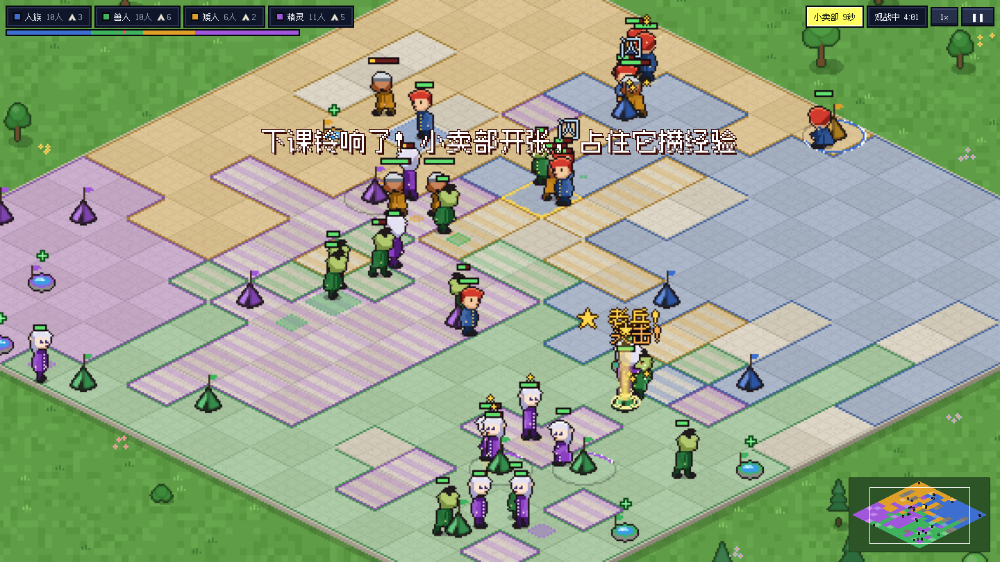
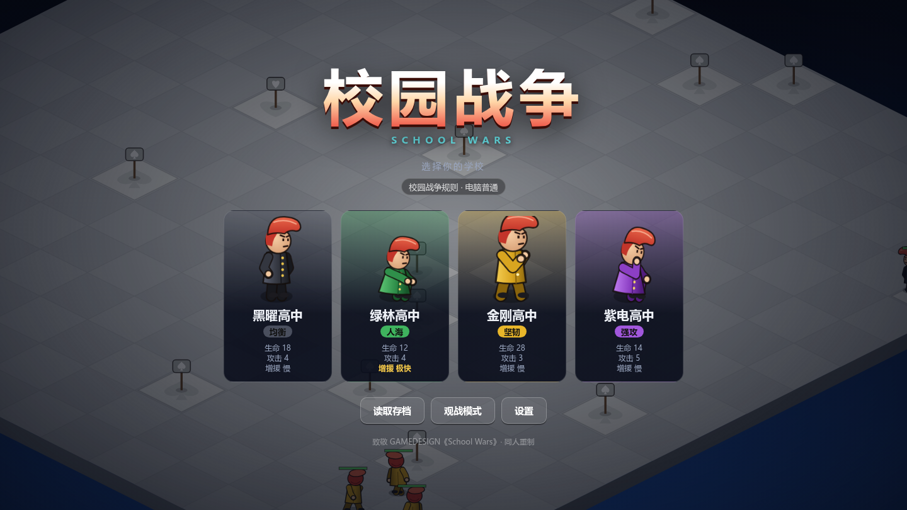

<div align="center">

# 校园战争 · School Wars

**致敬 GAMEDESIGN 经典 Flash 即时战略游戏《School Wars》的同人重制版**

简体中文 | [English](README.en.md)

[](http://schoolwars.yhdmt.site)
[](https://github.com/mituan-ai/school-wars/releases)
[](LICENSE)




</div>

四所高中、一张 16×16 的等距棋盘、两种指令：**移动**和**攻击**。学生闲下来就会坐下，坐在 ♠ 上能占领它、加快增援，坐在 ♥ 上能回血。把对手的本部坐到沦陷，再把最后一个人击倒，就赢了。

这是一个小时候最爱的游戏。重制版先按原版 SWF 逐函数还原了全部规则，再在不增加系统的前提下，改掉了原版拖沓、不讲理的地方。

## ✨ 特色

- **两套规则，设置里随时切换**
  - **校园战争（默认）**：对局能收尾，战斗更讲理。40 分钟分不出胜负的对局从原版的 57% 降到 1.7%。
  - **经典规则**：逐帧复刻原版，包括原版电脑 AI。
- **不作弊的电脑**：电脑和玩家用同样的规则、同样的指令。分简单、普通、困难三档，四所学校各有性格。
- **顺手的操作**：拖框选人、编队、双击全选、集结点、多人分散落点、威胁提醒、悬停说明。
- **全部重新绘制**：角色、校舍、地块都用代码绘制，音效用 WebAudio 合成。仓库里没有任何原版素材。
- **中文 / English 双语**，带存档读档（3 个手动档位 + 自动存档，可导出、导入）、暂停与倍速、色弱模式。
- **打开就能玩**：纯浏览器运行，没有运行时依赖，打包后约 80 KB（gzip 后 29 KB）。

<div align="center">

</div>

## 🎮 怎么玩

| | 规则 |
|---|---|
| **♠ 地块** | 坐在上面占领它。占的 ♠ 越多，增援越快 |
| **♥ 地块** | 坐在己方的 ♥ 上回血。也可以占领 |
| **本部** | 每所学校的大本营：出兵、回血。敌人在你的本部上坐满约 33 秒·人，本部**沦陷**：停止增援、不能回血。派人坐回去约 17 秒·人就能夺回 |
| **出局** | 本部沦陷，并且一个学生都不剩 |
| **击倒成长** | 每击倒一人：回血 30%、生命上限 +2；每击倒 3 人头顶多一颗星 |
| **众矢之的** | 势力超过全场 40% 的学校会成为其他电脑优先攻击的对象（只剩两所学校时取消） |

出拳命中率是 50%，挥空时会冒出"闪"字。被打中会打断出拳，所以围殴很强，这是原版最有味道的地方，重制版完整保留了。

### 操作

| 操作 | 按键 |
|---|---|
| 选中 | 左键点击或拖框 · 双击学生选中屏幕内全部己方学生 · `Ctrl` + `A` 全选 |
| 移动 / 攻击 | 右键地面 / 右键敌人 |
| 编队 | `Ctrl` 或 `Shift` + 数字编队 · 数字键选队 · 连按两次镜头跳过去 |
| 集结点 | 点自己的校舍，再右键地面，新兵会自动前往 · 右键本部取消 |
| 视野 | `空格` + 拖动 · `WASD` / 方向键 · 点小地图 · 滚轮缩放 |
| 暂停 / 倍速 | 右上角按钮 |

### 四所学校

| 学校 | 特点 | 生命 | 攻击 | 增援 |
|---|---|---|---|---|
| ⚫ 黑曜高中 | 均衡 | 18（原版 20） | 4 | 慢 |
| 🟢 绿林高中 | 人海 | 12（原版 10） | 4（原版 2） | 极快 |
| 🟡 金刚高中 | 坚韧 | 28（原版 25） | 3 | 慢 |
| 🟣 紫电高中 | 强攻 | 14（原版 15） | 5 | 慢 |

括号里是经典规则下的原版数值。新规则的数值是用上千局无头模拟调出来的，原版中绿林在电脑互打时胜率为 0%。

## 🔧 和原版相比改了什么

每一条改动都能用一句话讲清楚，并且用无头模拟验收过：

- **让对局能收尾**：本部可以被攻陷；增援在人满时攒着，不再白白浪费；没人继续占领的地块，进度会慢慢回退；"众矢之的"只剩两家时取消，而且不再保护本部已沦陷的学校。
- **战斗更讲理**：闲着的学生优先迎战最近、正在打自己人的敌人，而不是随机挑一个；走动中的单位也能被打中；执行移动指令时不会被敌人拉走；自动追击最远 12 格；倒地的学生立即让出格子。
- **看得懂**：势力比例条、占领进度环、增援倒计时、挥空提示、受击闪白、击倒星星、悬停说明。

完整的设计、数据和取舍见 [docs/03_优化方案.md](docs/03_优化方案.md)。

## 🤖 电脑 AI 实测

所有数据都来自可复现的无头模拟（`npm run sim`，40 分钟为上限）：

| 对局 | 结果 |
|---|---|
| 普通 × 4 混战（300 局） | 四校胜率 26 / 27 / 20 / 25%，中位时长 14 分钟，1.7% 未分胜负 |
| 困难 vs 原版 AI | 困难方赢 98.9% |
| 普通 vs 原版 AI | 普通方赢 77.8% |
| 困难 vs 普通 | 困难方赢 86.9% |

指挥官每隔一段时间评估一次局势，把学生分配到撤退、防守、扩张、进攻四类任务。它只能下达和玩家一样的指令，不读取任何玩家看不到的信息，也没有属性加成。三档难度的差别只在反应速度、协同程度和是否集火。

## 🚀 本地运行

需要 [Node.js](https://nodejs.org/) **22.18** 或更高版本（命令行工具直接运行 `.ts` 文件）。

```bash
git clone https://github.com/mituan-ai/school-wars.git
cd school-wars
npm install
npm run dev          # 开发服务器，浏览器打开显示的地址
```

| 命令 | 作用 |
|---|---|
| `npm run build` | 类型检查 + 生产构建到 `dist/`（纯静态文件，任何 Web 服务器都能托管） |
| `npm test` | 54 项规则、AI 与模拟测试 |
| `npm run sim -- 300 40 --rules remake --ai normal` | 无头跑观战局：局数、最长分钟、规则、难度 |
| `npm run sim -- 100 40 --rules remake --vs hard,classic` | 两种 AI 各控制两所学校，统计胜者 |
| `node tools/balance.ts 160 '18,12,28,14' '4,4,3,5' '1500,500,1500,1500' hard` | 阵营数值扫参 |

## 🏗️ 技术架构

- **TypeScript（strict）+ Vite + Canvas 2D**，界面用原生 DOM，没有框架，也没有运行时依赖。
- **确定性的纯逻辑核心**：`src/core/` 不依赖浏览器，固定 18 tick/s，随机数带种子并保存在状态里。同样的种子和指令一定得到同样的对局，存档就是状态本身的 JSON。
- **原版对照**：经典规则下，核心逐函数对应原版 ActionScript（文件头标注了出处帧）。改动前后各跑 20 局 × 6000 帧，事件流指纹完全一致。
- **测试驱动平衡**：测试里内置了小型锦标赛门槛，例如困难 AI 对原版 AI 胜率要超过 75%，普通混战的僵局不超过 10%。调 AI 或数值时测试会把关。

```
src/core/          纯逻辑，可在 Node 中无头运行
  mapgen.ts        地图生成与开局
  spawn.ts         增援
  unit.ts          单位状态机、战斗、占领
  ai-classic.ts    原版电脑 AI
  ai-commander.ts  新电脑指挥官
  sim.ts           主循环与指令
  save.ts          存档（v2，自动迁移 v1）
src/render/        等距地图、矢量角色、小地图、特效
src/ui/            标题、对局界面、菜单、存读档与设置
src/i18n/          中文 / English
src/audio/         WebAudio 合成音效
tests/             Vitest 测试；e2e/ 为浏览器冒烟脚本
tools/             观战统计、数值扫参
```

## 📚 文档

- [docs/01_原版机制考证.md](docs/01_原版机制考证.md)：从 SWF 与反编译脚本还原的原版规则。每条都标了证据等级（确认 / 推导 / 未知）和出处行号
- [docs/02_重构方案.md](docs/02_重构方案.md)：技术选型、架构与里程碑
- [docs/03_优化方案.md](docs/03_优化方案.md)：新规则、新 AI、操作与画面的设计，以及实测数据和未达标项

## 🗺️ 路线图

- [ ] 困难难度下的阵营平衡（目前人海流的绿林偏强）
- [ ] 像素风中文字体、可选的背景音乐
- [ ] 学生姿势预渲染为位图，进一步降低渲染开销
- [ ] 触屏支持

欢迎提 Issue 和 PR。改动规则或 AI 时，请附上 `npm run sim` 的前后对比。

## 🙏 致谢与声明

- 原作《School Wars》由 [GAMEDESIGN](https://www.gamedesign.jp/)（伊藤太郎）制作。本项目是粉丝出于喜爱制作的非官方重制版，与原作者没有任何关联。
- "School Wars" 的名称与原作的版权归原作者所有。本仓库**不包含**原版 SWF、反编译代码或任何原版图像、音效素材。所有美术、音效和代码都是重新制作的。
- 如果原作者认为本项目有任何不妥，请提 Issue 联系，我们会立即处理。

本项目的代码以 [MIT 许可证](LICENSE) 开源。
